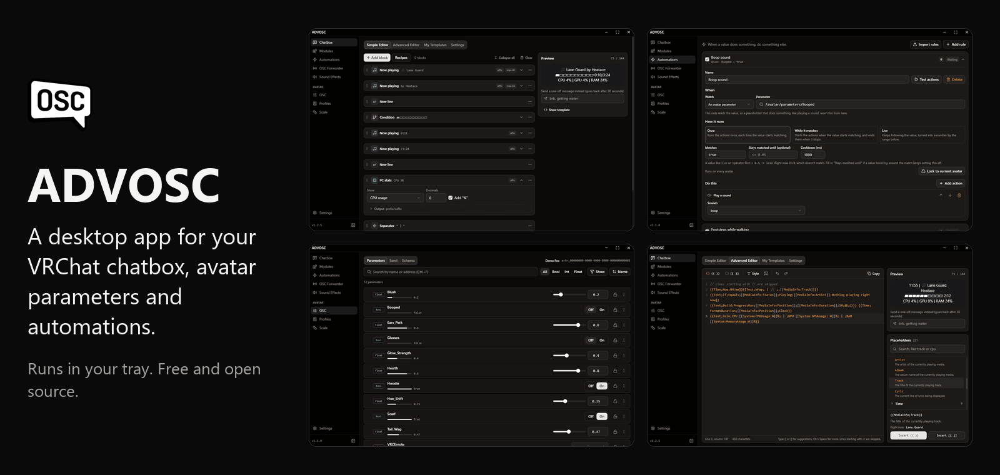

<p align="center">
  
</p>

<p align="center">
  <a href="https://github.com/TheArmagan/advosc/releases/latest"></a>
  <a href="https://discord.gg/spfmB7S78n"></a>
  <a href="https://patreon.com/armagan"></a>
  <a href="./LICENSE"></a>
</p>

ADVOSC is a desktop app for VRChat OSC. It started because I wanted a nicer chatbox than the ones I could find, and it grew from there. It sits in your tray and keeps working with the window closed.

It's Windows only, since a few parts (media info, trackers, hardware sensors) talk to Windows APIs directly.

## Install

Grab `ADVOSC-Setup.exe` from [Releases](https://github.com/TheArmagan/advosc/releases/latest) and run it. It installs and opens itself, there's no wizard to click through. After that it checks for updates on its own, downloads them in the background (you can watch the progress in the sidebar), and asks before it restarts.

If you'd rather update by hand, use the zip. It's the same app, it just never updates itself.

In VRChat, turn on OSC from the Action Menu (Options > OSC > Enabled). That's the only setup ADVOSC needs.

Something broke? Come say hi on [Discord](https://discord.gg/spfmB7S78n).

## What it does

- **[Chatbox](./docs/CHATBOX.md):** build a live chatbox out of blocks, or write the template by hand. Save whole setups and share them.
- **[Modules](./docs/MODULES.md):** live data for the whole app, like media, heart rate, weather, PC stats, speech and any HTTP endpoint. This is the full placeholder list.
- **[Automations](./docs/AUTOMATIONS.md):** when a value does something, play a sound, send OSC, set a parameter, or run a toy.
- **[Avatars](./docs/AVATARS.md):** lock, link and animate parameters, save profiles, and resize yourself in game.
- **[OSC Forwarder](./docs/OSC_FORWARDER.md):** send any placeholder value to an OSC address on a timer.
- **[Sound Effects](./docs/SOUND_EFFECTS.md):** a soundboard that can react to your avatar.
- **[Toy control](./docs/TOYS.md):** Lovense and Intiface toys driven by automations. Off by default, with a panic stop and a max strength.
- **[Tray and backups](./docs/TRAY_AND_BACKUPS.md):** what happens when you close the window, and how your settings are backed up.
- **[Settings](./docs/SETTINGS.md):** OSC ports, extra OSC apps, and startup options.

To add contacts and SPS to an avatar along with the rules that react to them, see [ADVOSC Triggers](https://github.com/TheArmagan/advosc-triggers).

## What it does on your PC

You're running something I made on your machine, next to your game, so here's what that means.

**It talks to VRChat over OSC only.** That's VRChat's own official feature, on your own PC. ADVOSC doesn't touch the game's files or memory. It does read the avatar files VRChat writes to its LocalLow folder, which is how it knows your parameters.

**There's no account, and no analytics or telemetry.** Your settings stay in one folder on your PC.

**It goes online for a few specific things:**

- Checking for updates, through `update.electronjs.org`
- Looking up lyrics, which sends the track and artist name to `lrclib.net`
- Weather from Open-Meteo, if you use the Weather module
- Things you set up yourself: heart rate services, translation providers, and your own HTTP or WebSocket sources

**Sharing is careful with your keys.** Share codes leave out your API keys and tokens, and tell you what they removed. A share code from someone else can't bring in toy rules, and any other rules in it arrive turned off.

**The installer isn't code signed**, so Windows SmartScreen may warn you the first time. If you'd like to check before running it, all the code is here, and every release is built by [GitHub Actions](./.github/workflows/release.yml) from the tagged commit, so you can see exactly what went into it.

## Learning placeholders

New to things like `{{MediaInfo;Track}}`? The [placeholder guide](./LEARN_PLACEHOLDERS.md) starts from scratch, and [the expert one](./LEARN_PLACEHOLDERS_EXPERT.md) goes further once that clicks. You don't need either to get started, since the simple editor builds all of this for you.

## Coming soon

Local speech recognition with Whisper, as an offline alternative to the browser recognizer in the Speech module.

## Development

Bun, Electron, Svelte 5, and a bit of Rust for the Windows-only bits and audio.

```bash
bun install     # deps
bun run dev     # main + preload + engine + renderer + electron, all watching
bun run build   # production build into dist/
bun run package # distributable
```

## Support

ADVOSC is free and stays free. If it's become part of your VRChat nights and you'd like to help me keep working on it, you can support me on [Patreon](https://patreon.com/armagan). Telling a friend about it or reporting a bug on [Discord](https://discord.gg/spfmB7S78n) helps too.

## License

GPL-3.0. Made for the VRChat community, mostly at hours I should have been asleep.
