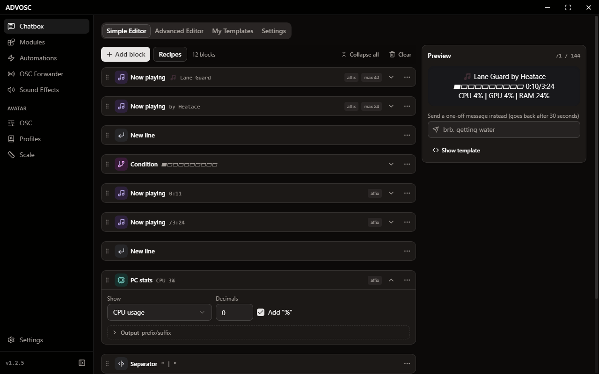
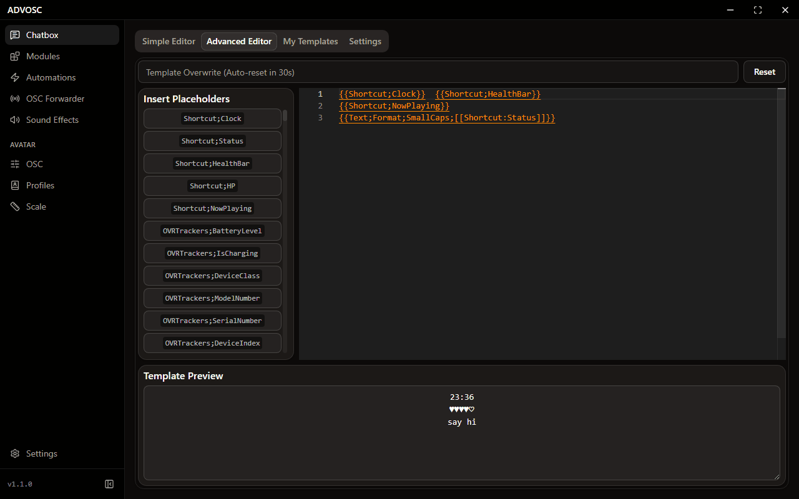
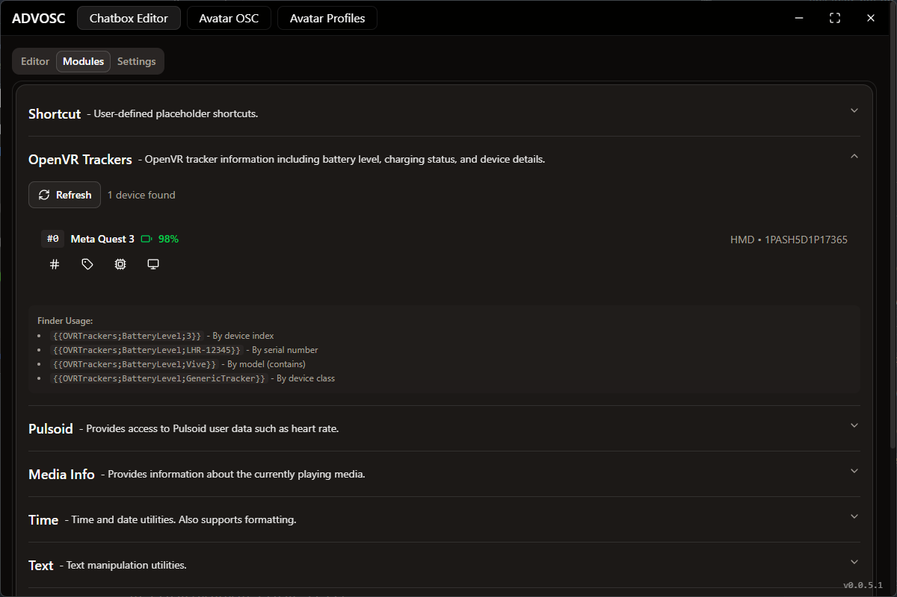
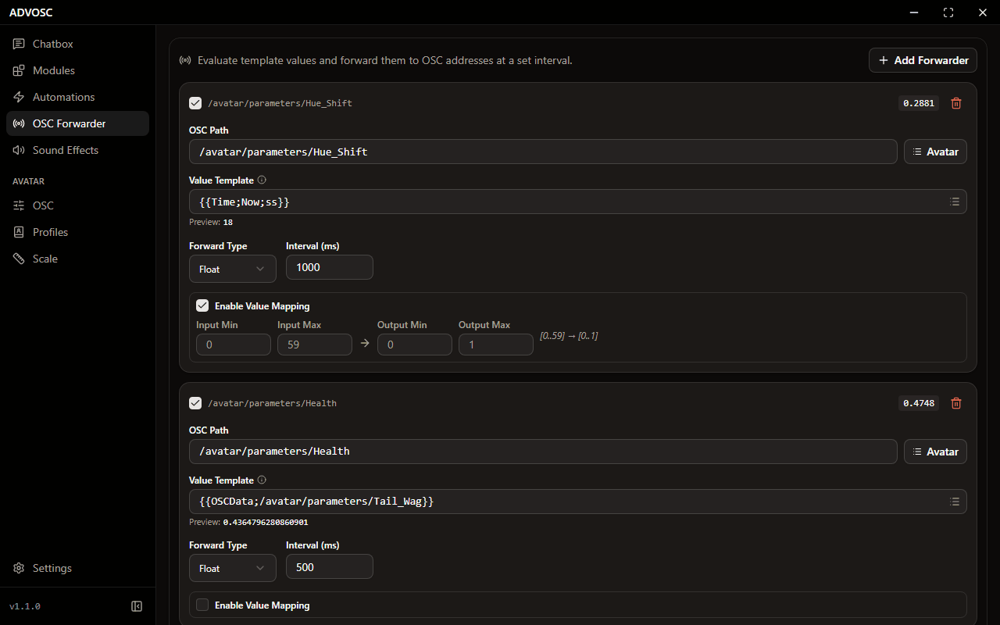

<p align="center">
  
</p>

<h1 align="center">ADVOSC</h1>

<p align="center">
  <a href="https://discord.gg/spfmB7S78n">
    
  </a>
  
  <a href="https://github.com/TheArmagan/advosc/releases/latest">
    
  </a>
  
</p>

ADVOSC is a desktop app for VRChat OSC. It started because I wanted a nicer chatbox than the ones I could find, and it grew from there: a chatbox template engine you can build with blocks or write by hand, modules that feed live data to the whole app, automations that react to it, avatar parameter control and profiles, avatar scaling, and an OSC forwarder.

Windows only, since a few parts (media info, trackers, hardware sensors) talk to Windows APIs directly.

Closing the window keeps ADVOSC running in the tray, and everything keeps working with no window open. See [Running in the tray](#running-in-the-tray).

Grab a build from [Releases](https://github.com/TheArmagan/advosc/releases/latest), or come say hi on [Discord](https://discord.gg/spfmB7S78n) if something breaks.

Run `ADVOSC-Setup.exe` and it installs and opens itself, there is no wizard to click through. After that it checks for updates on its own and downloads them in the background, then asks whether you want to restart. If you would rather not have that, use the zip instead: it is the same app, it just never updates itself.

---

## The chatbox

Everything in the chatbox is a template. You write text, and anywhere you want live data you drop in a placeholder like `{{MediaInfo;Track}}`. ADVOSC re-renders it every 2.2 seconds (VRChat's rate limit) and sends the result.

There are two ways to write one, and they both end up as the same template underneath, so you can start in one and finish in the other.

### Simple editor

<p align="center">
  
</p>

You stack blocks, reorder them, and watch the preview update as you go. No syntax to memorize. There are 30 block types:

| Category | Blocks |
|----------|--------|
| **Basic** | Text, Text Transform, Text Replace, Text Truncate, Text Pad, Text Fallback, Current Time, New Line |
| **Media** | Now Playing, Song Progress, Heart Rate |
| **Display** | Progress Bar, Health Bar, Star Rating, Toggle Text, Number Format |
| **Animate** | Marquee / Scroll, Bounce, Typewriter, Blink, Cycle Texts |
| **Logic** | Condition |
| **VRChat** | Hotkey State, Avatar Param, VR Tracker |
| **Tools** | Stopwatch, Session Time, Shortcut, Number Calc, Random Number |

The part that makes it actually usable for real templates: most blocks accept more than a plain value as their source. You can feed them:

- a literal like `42`, `true`, or some text
- an OSC address like `/avatar/parameters/Health`
- an inner placeholder like `[[MediaInfo:Duration]]`
- a full placeholder like `{{Shortcut;Time}}`

So mixing media data, tracker battery, heart rate, hotkeys and conditions in one visual flow works fine. A few things people tend to build:

- a now playing line that falls back to something else when nothing is playing
- a song progress bar with a moving head character
- a status line driven by a hotkey or an avatar parameter
- a weather line with a condition emoji, temperature and sunset time
- long media titles truncated so they fit, HP padded so the layout stops jumping
- numbers clamped, mapped into another range, rounded, or randomized
- marquee, blink, typewriter, rotating messages
- AFK or stream status that swaps text depending on a condition

### Advanced editor

<p align="center">
  
</p>

If you would rather just write the template, this is a real editor with autocomplete for every module and placeholder. Nothing is hidden from you here, and anything the simple editor can produce you can also write by hand.

Whichever editor you have open is the one that gets sent.

### My Templates

A saved template holds the whole setup: the template text, both editors' state, and every module's settings. So switching templates swaps your entire chatbox in one click instead of you rebuilding it.

| Action | What it does |
|--------|--------------|
| **Save Current As Template** | Snapshots your current setup under a name |
| **Use** | Switches to a saved template, and can save your current one first so you can come back |
| **Overwrite With Current Setup** | Updates a saved template in place after you tweak something |
| **Share** | Gives you a compact share code, the raw JSON, or a `.advosc.json` file |
| **Import** | Takes a share code, template JSON, template file, or an old "Export All Settings" bundle |

Sharing strips your credentials. Heart rate tokens, API keys, widget ids, custom WebSocket URLs and shortcuts you marked hidden never leave your machine, and the share window tells you exactly what it removed. There is a checkbox to include them on purpose if you are exporting a backup for yourself.

Imported templates just land in your list. Nothing switches until you say so.

---

## Modules

Modules are where live data comes from. They aren't only for the chatbox: the same placeholders work in automations, the OSC Forwarder, and anywhere else that takes a value. Many of them also have inputs, which are things the rest of the app can tell them to do, like starting a stopwatch. Inputs are listed on the Modules page and you can run them from an automation.

Click one to see what it does.

<details>
<summary><strong>🎵 Media Info</strong> :: whatever you are listening to</summary>

Reads Windows' own media session, so it works with Spotify, browsers, most players. Synced lyrics included when they exist.

| Placeholder | Output | Description |
|-------------|--------|-------------|
| `{{MediaInfo;Status}}` | `Playing` | Playback status (Playing, Paused, Stopped) |
| `{{MediaInfo;Track}}` | `Never Gonna Give You Up` | Track title |
| `{{MediaInfo;Artist}}` | `Rick Astley` | Artist name |
| `{{MediaInfo;Album}}` | `Whenever You Need Somebody` | Album name |
| `{{MediaInfo;Position}}` | `120000` | Current position in milliseconds |
| `{{MediaInfo;Duration}}` | `300000` | Total duration in milliseconds |
| `{{MediaInfo;AppName}}` | `Spotify` | Which app is playing it |
| `{{MediaInfo;Lyric}}` | `Never gonna give you up` | Current synced lyric line |

</details>

<details>
<summary><strong>🕒 Time</strong> :: clocks, dates, durations</summary>

| Placeholder | Output | Description |
|-------------|--------|-------------|
| `{{Time;NowMillis}}` | `1700000000000` | Current time in milliseconds (Unix epoch) |
| `{{Time;Now;HH:mm}}` | `14:30` | Current time, your format |
| `{{Time;Now;yyyy-MM-dd}}` | `2023-11-14` | Current date, your format |
| `{{Time;Timezone}}` | `America/New_York` | System timezone |
| `{{Time;UTCOffset}}` | `+00:00` | Current UTC offset |
| `{{Time;FormatDuration;3600000;Short}}` | `1h 0m 0s` | Milliseconds as a readable duration |
| `{{Time;ElapsedMillis;...}}` | `5000` | Time since a timestamp |

</details>

<details>
<summary><strong>🔤 Text</strong> :: transforms, bars, animations</summary>

The biggest module. Transform text, build meters out of it, animate it.

| Placeholder | Output | Description |
|-------------|--------|-------------|
| `{{Text;Upper;hello}}` | `HELLO` | Uppercase |
| `{{Text;Lower;HELLO}}` | `hello` | Lowercase |
| `{{Text;Title;hello world}}` | `Hello World` | Title case |
| `{{Text;Trim;  hello  }}` | `hello` | Strip surrounding whitespace |
| `{{Text;Replace;cat;dog;cat nap}}` | `dog nap` | Replace every match |
| `{{Text;Length;hello}}` | `5` | Length |
| `{{Text;Reverse;hello}}` | `olleh` | Reverse it |
| `{{Text;Repeat;3;Hi }}` | `Hi Hi Hi ` | Repeat N times |
| `{{Text;Slice;0;5;Hello World}}` | `Hello` | Substring |
| `{{Text;Format;Rounded;text}}` | `ⓣⓔⓧⓣ` | Unicode styling |
| `{{Text;Format;Bold;text}}` | `𝐭𝐞𝐱𝐭` | One of the newer styles |
| `{{Text;Truncate;10;Long text...}}` | `Long text...` | Cut with an ellipsis |
| `{{Text;Build;ProgressBar;30;100;10;█;░;▓}}` | `██▓░░░░░░░` | Progress bar, optional head character |
| `{{Text;Build;HealthBar;3;5;♥;♡}}` | `♥♥♥♡♡` | Hearts style meter |
| `{{Text;Build;StarRating;3;5;★;☆}}` | `★★★☆☆` | Rating display |
| `{{Text;Build;Toggle;true;ON;OFF}}` | `ON` | Truthy or falsy to text |
| `{{Text;NumberFormat;2;.;,;1234.5}}` | `1,234.50` | Format a number for display |
| `{{Text;Animate;Marquee;...}}` | `scrolling` | Marquee |
| `{{Text;Animate;Typewriter;Hello}}` | `H` → `He` → `Hel` | Reveal over time |
| `{{Text;Animate;Blink;ON;OFF}}` | `ON` → `OFF` | Alternate two texts |
| `{{Text;Animate;EachOne;A;B;C}}` | `A` → `B` → `C` | Cycle through items |

</details>

<details>
<summary><strong>🔢 Number</strong> :: math and randomness</summary>

| Placeholder | Output | Description |
|-------------|--------|-------------|
| `{{Number;Random;Int;1;100}}` | `42` | Random integer in a range |
| `{{Number;Random;Float;0;1}}` | `0.7531` | Random float in a range |
| `{{Number;Clamp;150;0;100}}` | `100` | Keep a value inside bounds |
| `{{Number;Map;5;0;10;0;100}}` | `50` | Remap one range onto another |
| `{{Number;Floor;3.7}}` | `3` | Round down |
| `{{Number;Ceil;3.2}}` | `4` | Round up |
| `{{Number;Round;3.5}}` | `4` | Round to nearest |
| `{{Number;Abs;-5}}` | `5` | Absolute value |

</details>

<details>
<summary><strong>🧪 Expression</strong> :: conditions and real math</summary>

When a condition gets too weird for the other modules, write it out.

| Placeholder | Output | Description |
|-------------|--------|-------------|
| `{{Expr;5 > 3;Yes;No}}` | `Yes` | If / else |
| `{{Expr;Math.sqrt(16)}}` | `4` | Math expressions |
| `{{Expr;Math.sin(Math.PI/2)}}` | `1` | Trig |
| `{{Expr;[[MediaInfo:Status]]=='Playing';🎵;⏸️}}` | `🎵` | Conditions on live data |

</details>

<details>
<summary><strong>❤️ Heart Rate</strong> :: Pulsoid, HypeRate, Stromno, custom</summary>

Add your feeds under **Modules → Heart Rate**. Each one gets a name that you use in the placeholder, so your token never ends up sitting inside a template you might share.

| Platform | What you need |
|----------|---------------|
| Bluetooth (BLE) | A band or strap broadcasting heart rate. Hit Scan and pick it from the list |
| Pulsoid | Access token |
| HypeRate | API key + session id |
| Stromno | Widget id |
| Custom WebSocket | WebSocket URL + optional JSON path (like `data.heartRate`) |

| Placeholder | Output | Description |
|-------------|--------|-------------|
| `{{HeartRate;SOURCE;HeartRate}}` | `75` | Current heart rate |
| `{{HeartRate;SOURCE;IsOnline}}` | `true` | Connection status |
| `{{HeartRate;SOURCE;AverageHR;300}}` | `72` | Average over N seconds (max 900) |
| `{{HeartRate;SOURCE;MaxHR}}` | `120` | Session maximum |
| `{{HeartRate;SOURCE;MinHR}}` | `55` | Session minimum |
| `{{HeartRate;SOURCE;Battery}}` | `84` | Device battery percentage (Bluetooth only) |
| `{{HeartRate;SOURCE;HasContact}}` | `true` | Skin contact (Bluetooth only) |
| `{{HeartRate;SOURCE;DeviceName}}` | `Xiaomi Smart Band 10 Pro` | Advertised device name (Bluetooth only) |
| `{{HeartRate;SOURCE;SensorLocation}}` | `Wrist` | Where the device is worn (Bluetooth only) |

**Bluetooth notes.** Anything implementing the standard heart rate service (`0x180D`) works: Coospo, Polar, Garmin, Amazfit, Xiaomi and so on. There is no pairing step, and you should not pair the device in Windows Settings, since a bonded device that is not broadcasting is a common cause of stuck connections.

Your device has to actually be broadcasting. On Xiaomi bands that is Settings → Heart rate → Bluetooth broadcast, and it is off by default. While broadcasting, the band drops its connection to your phone, so if the phone app grabs it first the PC will never see it. Broadcast usually stops when the band screen goes back to the watchface. Drops are normal and ADVOSC reconnects on its own with a backoff.

> Old templates using `{{Pulsoid;TOKEN;…}}` migrate themselves: the token becomes a named source and the template gets rewritten. `Pulsoid` still works as an alias too.

</details>

<details>
<summary><strong>📡 OSC Data</strong> :: raw avatar parameters</summary>

| Placeholder | Output | Description |
|-------------|--------|-------------|
| `{{OSCData;/avatar/parameters/AFK}}` | `true` | Any OSC parameter value |
| `{{OSCData;/avatar/parameters/VelocityX}}` | `0.5` | Floats too |

</details>

<details>
<summary><strong>🎮 OpenVR Trackers</strong> :: battery and status</summary>

<p align="center">
  
</p>

| Placeholder | Output | Description |
|-------------|--------|-------------|
| `{{OVRTrackers;BatteryLevel;finder}}` | `85` | Battery level (0-100) |
| `{{OVRTrackers;IsCharging;finder}}` | `true` | Charging or not |
| `{{OVRTrackers;ModelNumber;finder}}` | `Vive Tracker 3.0` | Model |
| `{{OVRTrackers;SerialNumber;finder}}` | `LHR-12345678` | Serial |
| `{{OVRTrackers;IsExists;finder}}` | `true` | Whether it is there at all |

The finder can be a device index, serial number, device class, or model number.

</details>

<details>
<summary><strong>⚙️ Process</strong> :: is it running, and for how long</summary>

| Placeholder | Output | Description |
|-------------|--------|-------------|
| `{{Process;IsRunning;VRChat.exe}}` | `true` | Running or not |
| `{{Process;StartedAt;VRChat.exe}}` | `1700000000000` | Start timestamp |
| `{{Process;SessionTime;VRChat.exe}}` | `3600000` | Time since it started |

</details>

<details>
<summary><strong>🖥️ System Resources</strong> :: CPU, GPU, memory, network</summary>

What your PC is doing right now, sampled by a native helper twice a second.

**CPU**

| Placeholder | Output | Description |
|-------------|--------|-------------|
| `{{System;CPUName}}` | `AMD Ryzen 9 7950X 16-Core Processor` | Processor name |
| `{{System;CPUUsage}}` | `13.7` | Overall usage percentage |
| `{{System;CPUCoreUsage;0}}` | `24.5` | One logical core, zero based index |
| `{{System;CPUCores}}` | `16` | Physical core count |
| `{{System;CPUThreads}}` | `32` | Thread count |
| `{{System;CPUFrequency}}` | `4501` | Current frequency in MHz |
| `{{System;CPUTemperature}}` | `62` | Celsius, empty when Windows exposes no sensor |

**Memory**

| Placeholder | Output | Description |
|-------------|--------|-------------|
| `{{System;MemoryUsed}}` | `31.2 GB` | In use |
| `{{System;MemoryTotal}}` | `127.2 GB` | Total physical memory |
| `{{System;MemoryAvailable}}` | `95.9 GB` | Available to applications |
| `{{System;MemoryUsage}}` | `24.6` | Usage percentage |
| `{{System;SwapUsed}}` | `0 B` | Page file in use |
| `{{System;SwapTotal}}` | `8 GB` | Total page file size |
| `{{System;SwapUsage}}` | `0.0` | Page file usage percentage |

**GPU.** Every GPU placeholder takes an optional finder as its first parameter: a zero based index, or part of the name or vendor. Leave it empty and you get the GPU with the most VRAM, which is the discrete card on a laptop or APU system.

| Placeholder | Output | Description |
|-------------|--------|-------------|
| `{{System;GPUName}}` | `NVIDIA GeForce RTX 3070 Ti` | GPU name |
| `{{System;GPUVendor}}` | `NVIDIA` | NVIDIA, AMD, Intel or Unknown |
| `{{System;GPUUsage}}` | `42.0` | Utilization percentage |
| `{{System;VRAMUsed}}` | `2.7 GB` | VRAM in use |
| `{{System;VRAMTotal}}` | `8 GB` | Total VRAM |
| `{{System;VRAMUsage}}` | `34.3` | VRAM usage percentage |
| `{{System;GPUTemperature}}` | `53` | Celsius, NVIDIA only |
| `{{System;GPUPower}}` | `52.1` | Watts, NVIDIA only |
| `{{System;GPUFanSpeed}}` | `0` | Fan percentage, NVIDIA only |
| `{{System;GPUCoreClock}}` | `1020` | Core clock in MHz, NVIDIA only |
| `{{System;GPUCount}}` | `2` | How many GPUs were found |
| `{{System;GPUUsage;intel}}` | `3.0` | Usage of whichever GPU matches the finder |

**Network and uptime**

| Placeholder | Output | Description |
|-------------|--------|-------------|
| `{{System;Upload}}` | `1.5 MB/s` | Current upload speed |
| `{{System;Download}}` | `12.1 MB/s` | Current download speed |
| `{{System;TotalUploaded}}` | `32.6 GB` | Uploaded since boot |
| `{{System;TotalDownloaded}}` | `24.0 GB` | Downloaded since boot |
| `{{System;Uptime}}` | `22h 41m` | Since boot, also takes `seconds`, `minutes`, `hours`, `days` or `clock` |

**Units and decimals.** Every byte and speed placeholder takes a unit and a decimal count. With `auto` (the default) the value scales itself and keeps its label. Give it an explicit unit and you get a bare number, which is what you want when feeding it into math or a progress bar.

| Placeholder | Output | Description |
|-------------|--------|-------------|
| `{{System;MemoryUsed}}` | `31.2 GB` | Auto unit, one decimal |
| `{{System;MemoryUsed;GB}}` | `31.2` | Fixed unit, number only |
| `{{System;MemoryUsed;GB;0}}` | `31` | Fixed unit and decimal count |
| `{{System;CPUUsage;0}}` | `14` | Percentages take a decimal count directly |
| `{{System;Download;MB;2}}` | `12.15` | MB/s as a bare number |

Heads up: GPU temperature, power, fan speed and core clock come from NVIDIA's NVML, so they are empty on AMD and Intel. Usage and VRAM work everywhere. CPU temperature needs a sensor Windows actually exposes, which it usually does not.

</details>

<details>
<summary><strong>🌤️ Weather</strong> :: current conditions and forecast</summary>

Live weather and a 7 day forecast from [Open-Meteo](https://open-meteo.com), free and no API key needed. Save your locations under **Modules → Weather**. Each gets a name, and the first one becomes the default that gets used when you leave the location parameter empty.

The location parameter takes a saved name, any place name (it gets looked up for you), or `lat,lon` coordinates.

**Right now**

| Placeholder | Output | Description |
|-------------|--------|-------------|
| `{{Weather;Temperature}}` | `21.4` | Temperature at your default location |
| `{{Weather;Temperature;Home}}` | `21.4` | Temperature at a saved location |
| `{{Weather;FeelsLike;Tokyo}}` | `19.8` | Apparent temperature |
| `{{Weather;Condition}}` | `Partly cloudy` | Condition as text |
| `{{Weather;Emoji}}` | `⛅` | Condition as an emoji, day and night aware |
| `{{Weather;Code}}` | `2` | WMO weather code |
| `{{Weather;Humidity}}` | `63` | Relative humidity percent |
| `{{Weather;Precipitation}}` | `0.2` | Precipitation of the last hour |
| `{{Weather;Rain}}` | `0.2` | Rain and showers of the last hour |
| `{{Weather;Snowfall}}` | `0` | Snowfall of the last hour |
| `{{Weather;WindSpeed}}` | `12` | Wind speed |
| `{{Weather;WindGusts}}` | `24` | Gusts |
| `{{Weather;WindDirection}}` | `270` | Direction in degrees |
| `{{Weather;WindCompass}}` | `W` | Direction as a compass point |
| `{{Weather;CloudCover}}` | `48` | Cloud cover percent |
| `{{Weather;Pressure}}` | `1013` | Surface pressure in hPa |
| `{{Weather;IsDay}}` | `true` | Daytime at that location |

**Forecast.** The last parameter is the day offset: `0` today, `1` tomorrow, up to `6`.

| Placeholder | Output | Description |
|-------------|--------|-------------|
| `{{Weather;High;;0}}` | `24.1` | Day's high |
| `{{Weather;Low;;0}}` | `12.6` | Day's low |
| `{{Weather;Sunrise;;0}}` | `1700000000000` | Sunrise timestamp in milliseconds |
| `{{Weather;Sunset;;0}}` | `1700000000000` | Sunset timestamp in milliseconds |
| `{{Weather;UVIndex;;0}}` | `5.3` | Max UV index of the day |
| `{{Weather;PrecipitationChance;;1}}` | `40` | Chance of precipitation percent |
| `{{Weather;PrecipitationSum;;1}}` | `3.4` | Total precipitation for the day |
| `{{Weather;DailyCondition;;1}}` | `Slight rain` | Condition text for the whole day |
| `{{Weather;DailyEmoji;;1}}` | `🌦️` | Condition emoji for the whole day |
| `{{Weather;Date;;1}}` | `2023-11-15` | Local calendar date |

**Location and status**

| Placeholder | Output | Description |
|-------------|--------|-------------|
| `{{Weather;Location}}` | `Berlin, Berlin, DE` | Resolved location name |
| `{{Weather;Timezone}}` | `Europe/Berlin` | Timezone there |
| `{{Weather;UpdatedAt}}` | `1700000000000` | When it was last fetched |
| `{{Weather;IsOnline}}` | `true` | Whether the last fetch worked |
| `{{Weather;Unit;Temperature}}` | `°C` | Unit symbol for `Temperature`, `Wind` or `Precipitation` |

Units (Celsius / Fahrenheit, km/h / m/s / mph / knots, mm / inch) and the refresh interval live in the module tab. Timestamps pair up with the Time module:

```
{{Weather;Emoji}} {{Weather;Temperature}}{{Weather;Unit;Temperature}} • sunset {{Time;Timestamp;[[Weather:Sunset]];HH:mm}}
```

</details>

<details>
<summary><strong>🌐 HTTP & WebSocket</strong> :: pull in anything else</summary>

If a module for it does not exist, make one out of this. Add endpoints under **Modules → HTTP & WebSocket** and each gets a name you use in placeholders.

Two kinds of source:

- **HTTP Request.** Any method with your own headers and body. Polled on the interval you pick, and only while a template is actually using it.
- **WebSocket.** Stays connected and reconnects on its own. Placeholders read the latest message that arrived. You can send a subscribe or auth message on connect, and a keepalive on a timer.

The URL, headers and body can all contain placeholders, filled in right before the request goes out, so a request can be built from live data.

**Reading values.** Bodies get parsed as JSON and the path parameter walks into them: `data.items[0].title`. Array indexes can be negative to count from the end (`[-1]` is the last), quoted keys handle weird names (`["odd key"]`), and `length` works on arrays. Empty path gives you the whole body. Anything that is not JSON comes back as plain text.

| Placeholder | Output | Description |
|-------------|--------|-------------|
| `{{Request;Value;MyApi;data.value}}` | `42` | Value at a JSON path in the latest body |
| `{{Request;Value;MyApi;items[0].name}}` | `Sword` | Array indexing, negatives count from the end |
| `{{Request;Value;MyApi}}` | `{"data":{"value":42}}` | Whole body when the path is empty |
| `{{Request;Text;MyApi}}` | `{"data":{"value":42}}` | Raw body exactly as received |
| `{{Request;Has;MyApi;data.value}}` | `true` | Whether that path exists |
| `{{Request;Get;https://api.example.com/x;data.value}}` | `42` | One-off GET, no source to configure |
| `{{Request;Get;https://api.example.com/x;data.value;300}}` | `42` | Same, with a refresh interval in seconds |

**Status**

| Placeholder | Output | Description |
|-------------|--------|-------------|
| `{{Request;IsOnline;MyApi}}` | `true` | Last request worked, or the socket is connected |
| `{{Request;Status;MyApi}}` | `200` | HTTP status code, empty for WebSocket sources |
| `{{Request;Ok;MyApi}}` | `true` | Whether that status was 2xx |
| `{{Request;Error;MyApi}}` | `Request timed out after 10000ms` | Last error, empty when things are fine |
| `{{Request;Count;MyApi}}` | `7` | Responses received, or messages that arrived |
| `{{Request;UpdatedAt;MyApi}}` | `1700000000000` | When data last arrived, in milliseconds |
| `{{Request;Age;MyApi}}` | `12` | Seconds since data last arrived |
| `{{Request;Header;MyApi;content-type}}` | `application/json` | A header from the latest response |

Pair it with Expr to show something sensible while a source is down:

```
{{Expr;[[Request:IsOnline:MyApi]]=='true';Players online: [[Request:Value:MyApi:server.players]];Server offline}}
```

Requests are made by ADVOSC itself and not by the page, so browser CORS rules do not apply and any endpoint works. Bodies are capped at 2 MB. A source is only polled while a template or the module tab is using it, and a source that is already failing never blocks your chatbox while it retries.

</details>

<details>
<summary><strong>⌨️ Hotkey</strong> :: press a key, change the chatbox</summary>

| Placeholder | Output | Description |
|-------------|--------|-------------|
| `{{Hotkey;IsPressed;MyHotkey;1000}}` | `true` | Pressed within a timeout |
| `{{Hotkey;IsToggled;MyHotkey}}` | `false` | Toggle state, press to flip |

</details>

<details>
<summary><strong>⏱️ Stopwatch</strong> :: timers driven by hotkeys</summary>

Stopwatches you control with hotkeys from the Hotkey module. Good for AFK detection and session tracking.

| Placeholder | Output | Description |
|-------------|--------|-------------|
| `{{Stopwatch;ElapsedMs;MyTimer}}` | `125000` | Elapsed milliseconds |
| `{{Stopwatch;IsRunning;MyTimer}}` | `true` | Currently running |
| `{{Stopwatch;IsPaused;MyTimer}}` | `false` | Currently paused |

The hotkey actions are Start/Toggle, Pause (keeps the time), Reset (back to zero, keeps running), Stop (reset and pause), and Reset + Start, which is the one you want for AFK timers.

</details>

<details>
<summary><strong>📝 Shortcut</strong> :: name your own placeholders</summary>

Give a name to a chunk of placeholder soup you keep retyping, then use the name instead. The simple editor also generates these for you behind the scenes.

</details>

<details>
<summary><strong>🎤 Speech</strong> :: talk, and put it in the chatbox</summary>

Speech to text, with optional live translation. Electron has no speech recognition of its own, so ADVOSC starts a small server on your own machine and Chrome does the listening. Open the page from the Speech module tab, allow the microphone, and keep the tab open. Nothing leaves your machine except what Chrome sends to its own recognition service, and whatever the translation provider needs.

| Placeholder | Output | Description |
|-------------|--------|-------------|
| `{{Speech;Text}}` | `hey how are you doing` | Everything heard right now, including the words still being spoken |
| `{{Speech;Final}}` | `hey how are you doing` | Only the finished sentences |
| `{{Speech;Interim}}` | `and then i said` | Only the part still being spoken |
| `{{Speech;Last}}` | `how are you doing` | The most recent finished sentence |
| `{{Speech;Translated}}` | `hey nasılsın` | Translation of what is currently heard |
| `{{Speech;TranslatedFinal}}` | `hey nasılsın` | Translation of the finished sentences only |
| `{{Speech;Both; \| }}` | `hey how are you doing \| hey nasılsın` | Original and translation, with your separator |
| `{{Speech;IsListening}}` | `true` | The browser page has the mic open |
| `{{Speech;IsSpeaking}}` | `true` | Words are coming in right now |
| `{{Speech;HasText}}` | `true` | There is something to show |
| `{{Speech;IsMuted}}` | `false` | VRChat reports your own mic as muted |
| `{{Speech;Age}}` | `3200` | Milliseconds since the last thing you said |
| `{{Speech;Confidence}}` | `0.92` | Recognizer confidence for the last sentence, 0 to 1 |
| `{{Speech;Language}}` | `en-US` | Recognition language |
| `{{Speech;TargetLanguage}}` | `tr` | Language it translates into |
| `{{Speech;DetectedLanguage}}` | `en` | What the translation provider detected |
| `{{Speech;Provider}}` | `Google Translate` | Translation provider in use |
| `{{Speech;IsServerRunning}}` | `true` | The local speech server is up |
| `{{Speech;IsPageConnected}}` | `true` | The browser page is open and connected |
| `{{Speech;ServerUrl}}` | `http://127.0.0.1:7274/?t=...` | Address of the recognition page |
| `{{Speech;Error}}` | | Last recognition or translation error, empty when fine |

Translation supports four providers. Google works with no API key at all, so you can turn it on and it just goes. DeepL usually sounds the most natural. OpenRouter and Gemini run the text through an LLM, which handles slang and context better, and you can steer them with your own extra instructions. Keys are stored on your machine and are left out of template exports.

Text clears itself after a while so the chatbox does not keep showing something you said ten minutes ago. You can change the delay, how many sentences to keep at once, and a character cap, all on the module tab.

There is also an option to follow VRChat's own mute. Turn on "Clear and stop capturing while muted in VRChat" and muting yourself in game wipes the current text and closes the browser mic, then unmuting reopens it. It reads VRChat's `MuteSelf` parameter, so it needs OSC enabled in game like everything else here.

A line that only appears while you are talking:

```
{{Expr;[[Speech:HasText]]=='true';🎤 [[Speech:Both; | ]]}}
```

</details>

<details>
<summary><strong>🔊 Sound</strong> :: play sound effects from your library</summary>

Plays sounds you added on the Sound Effects page. The action placeholders render as nothing, so you can drop them anywhere in a template. They fire once when the optional condition turns true, then wait for it to go false again. Without a condition they fire once when the placeholder shows up. A placeholder that stays in your template does not replay every 2.2 seconds.

| Placeholder | Output | Description |
|-------------|--------|-------------|
| `{{Sound;Play;boop;condition}}` | | Plays `boop` when the condition turns true |
| `{{Sound;Loop;boop;condition}}` | | Loops `boop` while the condition is true, stops it when it turns false |
| `{{Sound;Stop;boop;condition}}` | | Stops every playing copy of `boop` |
| `{{Sound;StopAll;condition}}` | | Stops every sound |
| `{{Sound;Volume;50;condition}}` | | Sets the master volume, 0 to 100 |
| `{{Sound;IsPlaying;boop}}` | `true` | `boop` is playing right now |
| `{{Sound;Playing}}` | `boop, vine boom` | Names of everything playing right now |

Play a boop sound whenever someone boops you:

```
{{Sound;Play;boop;[[OSCData:/avatar/parameters/Booped]]}}
```

</details>

<details>
<summary><strong>📦 Variables</strong> :: named values you can set and read anywhere</summary>

A place to keep a value for later. An automation sets it, and anything that takes a placeholder can read it. Variables survive a restart, and they're not part of presets or share codes.

| Placeholder | Output | Description |
|-------------|--------|-------------|
| `{{Var;mood}}` | `sleepy` | The variable's value, or nothing if it isn't set |
| `{{Var;mood;fine}}` | `fine` | The variable's value, or the default if it isn't set |

To set one, add a **Set a variable** action to an automation.

</details>

<details>
<summary><strong>🔌 Lovense</strong> :: connected toys, once you've turned toy control on</summary>

Off until you turn on toy control in Settings. Reading these never starts a toy.

| Placeholder | Output | Description |
|-------------|--------|-------------|
| `{{Lovense;Connected}}` | `true` | At least one toy is connected |
| `{{Lovense;ToyCount}}` | `1` | How many toys are connected |
| `{{Lovense;Toys}}` | `Lush, Hush` | Names of the connected toys |
| `{{Lovense;Battery;Lush}}` | `80` | A toy's battery, or the lowest one if you don't name a toy |
| `{{Lovense;Status}}` | `Ready` | `Ready`, `Paused`, or `Panic` |

Its inputs are **Panic** and **Stop**, so an automation can stop everything from inside VR.

</details>

New to the syntax? The [Placeholder Learning Guide](./LEARN_PLACEHOLDERS.md) walks through the two-layer system from scratch, and [the expert one](./LEARN_PLACEHOLDERS_EXPERT.md) goes further once that clicks.

---

## Beyond the chatbox

### Automations

An automation watches a value and does something when it changes. The value can be any placeholder or an avatar parameter, so "when someone boops me, play a sound" and "while my heart rate is above 120, set this parameter" are both one rule.

A rule runs in one of three modes:

| Mode | What it does |
|------|--------------|
| **Once** | Fires one time each time the value starts matching |
| **While it matches** | Starts when the value starts matching, and ends when it stops |
| **Live** | Keeps following the value, mapped from one range to another |

The match can be a plain value (`1`, `true`, `idle`) or start with an operator (`> 0.5`, `!= 0`, `<= 3`). A rule can then do any mix of: play a sound, send OSC, set an avatar parameter, load an avatar profile, run a module input, set a variable, or control a toy. Live rules can only send OSC, set a parameter, set a variable, or link a toy, since the others don't make sense on a value that changes all the time.

Rules that read an avatar parameter react the moment OSC comes in, so short flips still get caught. A rule that fires too fast gets turned off with a note saying so, which stops two rules from setting each other off forever. Reset it from the page when you've fixed the cause.

A rule on a value that hovers around its threshold can use "Stays matched until". Once the rule matches, it stays matched until that second match is true, so `> 0.1` with `<= 0.05` fires once instead of flickering. A rule can also be locked to the avatar you're in, so it stays quiet on your other avatars.

If you had triggers in Sound Effects, they've been moved here for you.

#### Importing rules

You can add a set of rules from an `advosc://` link, a pasted `ADVOSCR1:` code or a `.advosc.json` file. Clicking a link opens ADVOSC, even from the tray. Import rules on the Automations page takes the code or the file.

You always see a review first: each rule's name, what it watches, when it runs and what it does. Every rule arrives off, and a rule you already added from the same set is skipped. Rules from a set can't hold placeholders, and they can only touch avatar parameters, variables, a sound slot you fill in yourself, and toys.

If a rule controls a toy, the review says so, and your max strength and panic hotkey still apply. If a rule reads a contact, an SPS socket or plug, or a Touch Zone, the review warns that anyone nearby can trigger it.

These sets usually come from [ADVOSC Triggers](https://github.com/TheArmagan/advosc-triggers), a Unity package that puts contacts and SPS on your avatar and writes the matching rules.

### Toy control

Off by default. ADVOSC doesn't connect to anything until you turn it on in Settings, and the Lovense page stays hidden until then. Turning it on asks you to set a panic hotkey that actually works and a max strength, which starts at 50%.

There are three ways to connect, and you can use more than one:

| Connection | What you need |
|------------|---------------|
| **Lovense Remote on this PC** | Lovense Remote running, with Game Mode on |
| **Lovense Remote on your phone** | Phone and PC on the same network, Game Mode on, then type in the IP and port it shows |
| **Intiface Central** | Intiface running on this PC. Also works with toys that aren't Lovense |

Toys are driven by automations, so anything ADVOSC can read can drive one. A **Live** rule can link an avatar float to strength, a **Once** rule can pulse for a few seconds, and rules can play Lovense's presets or your own patterns on one toy, several, or all of them.

Safety works like this:

- **Panic stop** is in the title bar, on the Lovense page, in the tray menu, on your hotkey, and available as a module input for VR. It stops everything and stays stopped until you re-arm. After a re-arm, rules that were running stay quiet until their value goes inactive once, so nothing jumps back on.
- **Max strength** applies to everything, including test buttons and patterns.
- **Commands run out by themselves.** Lovense toys get short commands that keep being renewed, so if ADVOSC crashes or your PC dies, the toy stops within a few seconds.
- **ADVOSC stops toys when VRChat closes.** If OSC goes quiet for a while it pauses Live and While rules and picks back up on the next message. Stopping on avatar change is optional.
- **Toy rules never leave your PC.** Share codes always strip them, and a share code someone gives you has them stripped again on import. Other rules from a share arrive turned off, and toy rules in an imported settings file arrive turned off too.

Intiface can't run a command for a limited time, so it's safer to set a ping time in Intiface Central. ADVOSC shows a warning if it isn't set.

### Avatar OSC control

<p align="center">
  
</p>

Every parameter on your avatar, in one list. You can lock a toggle so nothing changes it by accident, route one parameter's value into another, or animate one for breathing effects and color shifts.

<p align="center">
  
  
</p>

### Avatar profiles

<p align="center">
  
</p>

Save a whole parameter state (outfit, toggles, props, whatever mood you had going) and load it back in one click. Profiles export and import as JSON, and you can search or filter by avatar once you have collected a few too many.

### Avatar scale

Resize yourself in game by sending an eye height to VRChat, anywhere from `0.01` to `10.0` meters. Drag the slider or type an exact number, save your own named presets, and optionally have ADVOSC remember a height per avatar so it comes back on avatar change or instance join.

There is also parameter forwarding, so you can drive your size from inside your avatar: `/avatar/parameters/advosc_eyeheight` goes to `/avatar/eyeheight`, either normalized `0..1` onto a range you pick, or straight through as meters.

### OSC Forwarder

<p align="center">
  
</p>

Take any placeholder value and send it to an OSC address on a timer. The value field accepts any placeholder, so `{{OSCData;/avatar/parameters/X}}` or `{{Time;Now;HH:mm}}` both work. Pick the target path by hand or straight from the current avatar's schema, cast to `Float`, `Int`, `Bool` or `String`, optionally remap numbers from one range to another (`0..1` to `0..255`, say), and give each rule its own interval down to 100 ms.

### Sound Effects

A soundboard that reacts to your avatar.

Add audio files to the library and give each one a name. Each sound gets a play button, its own volume, a cooldown so it can't be spammed, an optional global hotkey (press Esc on the hotkey button to clear it), and an option to send an OSC value while it plays (for example `SoundPlaying=true`, then `false` when it ends) so an avatar animation can follow along. Sounds layer on top of each other if you trigger them again. The files stay where they are on disk and are not part of template exports.

To make a sound react to something, add a **Play a sound** action to an [automation](#automations). It plays one of its sounds at random, and a While rule can loop the sound or cut it off when the value stops matching.

You can pick the output device, so a virtual audio cable can send the sounds into your VRChat mic. There's also a master volume, a mute button, a Stop all button with its own hotkey, and an option to stop everything and hold new sounds while you're muted in VRChat.

Most audio formats work: mp3, wav, flac, ogg, opus, webm, m4a and aac. HE-AAC files play with the high end missing, HE-AACv2 files don't play, and AAC files have a small gap when they loop. A file that can't play shows why next to its name.

### Running in the tray

Closing the window sends ADVOSC to the tray, and everything keeps running with no window at all. To really quit, use **Quit** in the tray menu. **Start hidden** skips the window on launch.

ADVOSC doesn't use your GPU by default, so it takes up no video memory while you're in game. This matters because closing a window doesn't give video memory back on its own. If the window feels choppy, turn on **GPU acceleration** in Settings and restart.

### Backups

ADVOSC keeps a daily backup of your settings, seven days back. Settings > Backup has those, plus exporting everything to a file and restoring it. Exports include your API keys and tokens, so don't post them anywhere.

---

## Coming soon

Local speech recognition with Whisper, as an offline alternative to the browser recognizer in the Speech module.

---

## Development

Bun, Electron, Svelte 5, and a bit of Rust for the Windows-only bits and audio.

```bash
bun install     # deps
bun run dev     # main + preload + engine + renderer + electron, all watching
bun run build   # production build into dist/
bun run package # distributable
```

---

GPL-3.0. Made for the VRChat community, mostly at hours I should have been asleep.
