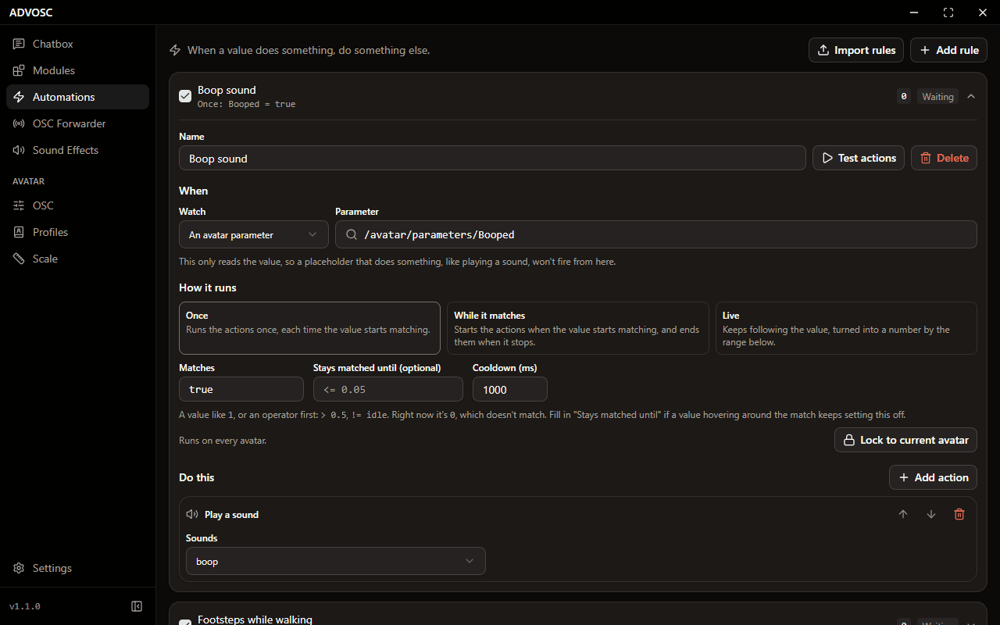
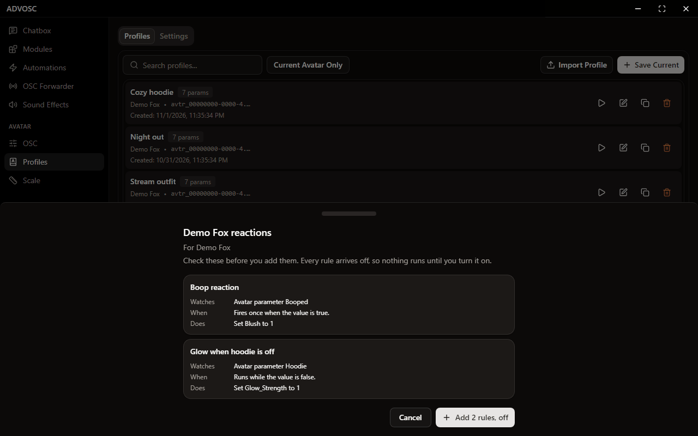

[Back to the README](../README.md)

# Automations

  

An automation watches a value and does something when it changes. The value can be any placeholder or an avatar parameter, so "when someone boops me, play a sound" and "while my heart rate is above 120, set this parameter" are both one rule.

A rule runs in one of three modes:

| Mode | What it does |
|------|--------------|
| **Once** | Fires one time each time the value starts matching |
| **While it matches** | Starts when the value starts matching, and ends when it stops |
| **Live** | Keeps following the value, mapped from one range to another |

The match can be a plain value (`1`, `true`, `idle`) or start with an operator (`> 0.5`, `!= 0`, `<= 3`). A rule can then do any mix of: play a sound, send OSC, set an avatar parameter, load an avatar profile, run a module input, set a variable, or control a toy. Live rules can only send OSC, set a parameter, set a variable, or have a toy follow the value, since the others don't make sense on a value that changes all the time.

**Test actions** runs a rule's actions once without waiting for the value, so you can check it before going in game.

Rules that read an avatar parameter react the moment OSC comes in, so short flips still get caught. A rule that fires too fast gets turned off with a note saying so, which stops two rules from setting each other off forever. Reset it from the page when you've fixed the cause. To slow one down on purpose, use **Cooldown (ms)**, or **Minimum time between updates (ms)** on a Live rule.

A rule on a value that hovers around its threshold can use "Stays matched until". Once the rule matches, it stays matched until that second match is true, so `> 0.1` with `<= 0.05` fires once instead of flickering. A rule can also be locked to the avatar you're in, so it stays quiet on your other avatars.

If you had triggers in Sound Effects, they've been moved here for you.

## Importing rules

  

You can add a set of rules from an `advosc://` link, a web link, a pasted `ADVOSCR1:` code, raw JSON, or a `.advosc.json` file. Clicking a link opens ADVOSC, even from the tray. **Import rules** on the Automations page takes everything else.

You always see a review first: each rule's name, what it watches, when it runs and what it does. Every rule arrives off, and a rule you already added from the same set is skipped. Rules from a set can't hold placeholders, and they can only touch avatar parameters, variables, a sound slot you fill in yourself, and toys.

If a rule controls a toy, the review says so, and your max strength and panic hotkey still apply. If a rule reads a contact, an SPS socket or plug, or a Touch Zone, the review warns that anyone nearby can trigger it.

A plain avatar parameter could be set by a contact, and nothing in its name says so. A toy rule that reads one gets a softer warning about that.

These sets usually come from [ADVOSC Triggers](https://github.com/TheArmagan/advosc-triggers), a Unity package that puts contacts and SPS on your avatar and writes the matching rules.
