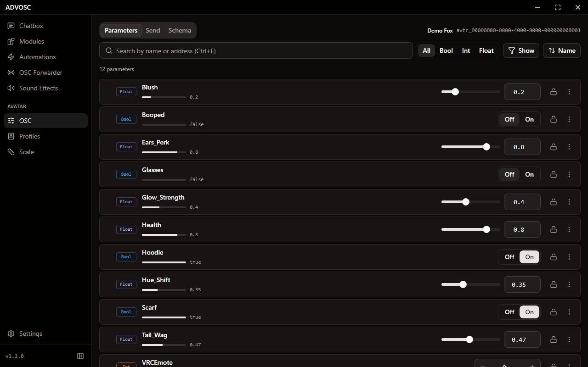
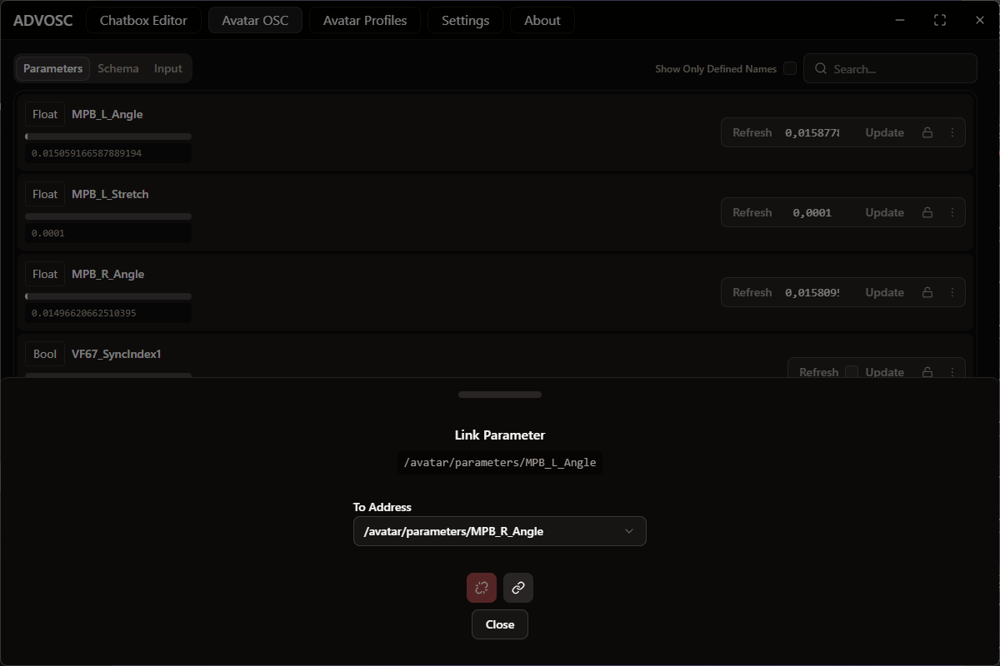
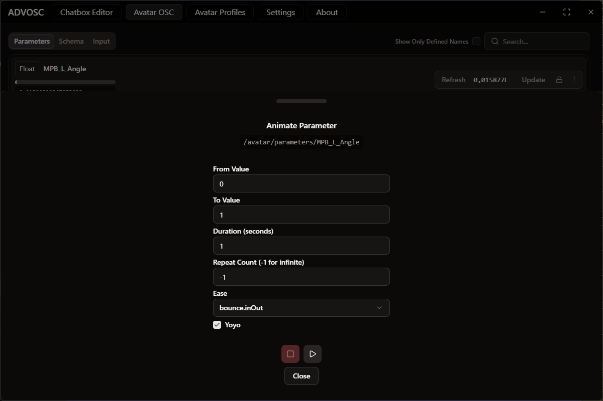
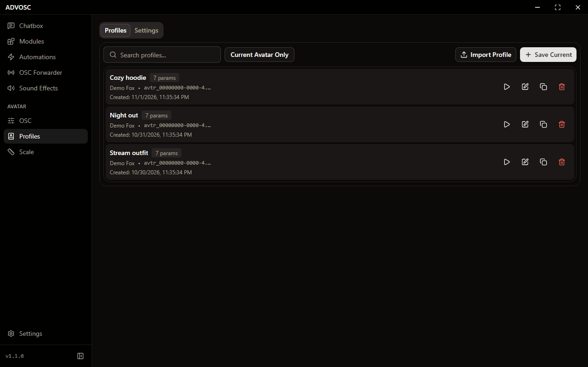

[Back to the README](../README.md)

# Avatars

## Avatar OSC control

  

Every parameter on your avatar, in one list. You can lock a toggle so nothing changes it by accident, route one parameter's value into another, or animate one for breathing effects and color shifts.

  
  

## Avatar profiles

  

Save a whole parameter state (outfit, toggles, props, whatever mood you had going) and load it back in one click. Profiles export and import as JSON, and you can search or filter by avatar once you have collected a few too many.

## Avatar scale

Resize yourself in game by sending an eye height to VRChat, anywhere from `0.01` to `10.0` meters. Drag the slider or type an exact number, save your own named presets, and optionally have ADVOSC remember a height per avatar so it comes back on avatar change or instance join.

There is also parameter forwarding, so you can drive your size from inside your avatar: `/avatar/parameters/advosc_eyeheight` goes to `/avatar/eyeheight`, either normalized `0..1` onto a range you pick, or straight through as meters.
