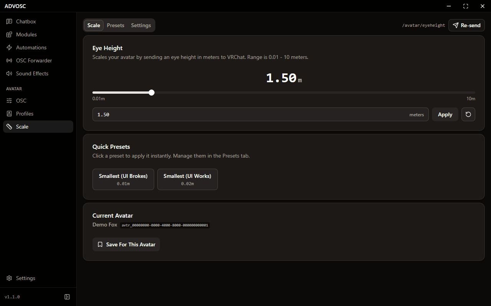

[Back to the README](../README.md)

# Avatars

## Avatar OSC control

  

Every parameter on your avatar, in one list. You can filter by type and search by name or address. From there you can lock a toggle so nothing changes it by accident, route one parameter's value into another, or animate one for breathing effects and color shifts.

The **Send** tab sends a value to any OSC address by hand, and the **Schema** tab shows your avatar's OSC schema.

## Avatar profiles

  

Save a whole parameter state (outfit, toggles, props, whatever mood you had going) and load it back in one click. Profiles export and import as JSON, and you can search or filter by avatar once you've collected a few too many. **Clear All Profiles** is on the Settings tab if you ever want a clean start.

## Avatar scale

  

Resize yourself in game by sending an eye height to VRChat, anywhere from `0.01` to `10.0` meters. Drag the slider or type an exact number, save your own named presets, and optionally have ADVOSC remember a height per avatar. It puts that height back on avatar change or instance join, after the **Restore Delay** you set. **Re-send** sends the current height again.

There's also parameter forwarding, so you can drive your size from inside your avatar: `/avatar/parameters/advosc_eyeheight` goes to `/avatar/eyeheight`, either normalized `0..1` onto a range you pick, or straight through as meters.
