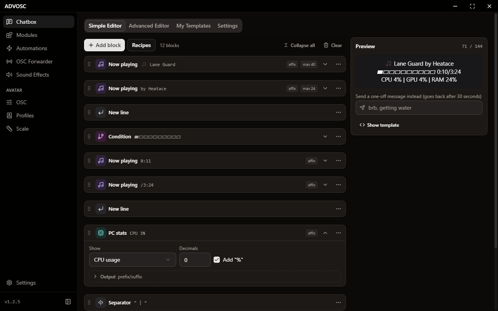
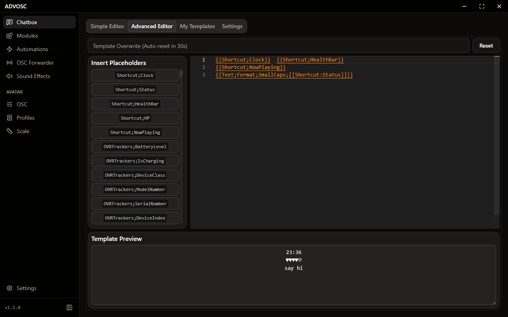

[Back to the README](../README.md)

# The chatbox

Everything in the chatbox is a template. You write text, and anywhere you want live data you drop in a placeholder like `{{MediaInfo;Track}}`. ADVOSC re-renders it every 2.2 seconds (VRChat's rate limit) and sends the result.

There are two ways to write one, and they both end up as the same template underneath, so you can start in one and finish in the other.

## Simple editor

  

You stack blocks, reorder them, and watch the preview update as you go. No syntax to memorize. There are 30 block types:

| Category | Blocks |
|----------|--------|
| **Basic** | Text, Text Transform, Text Replace, Text Truncate, Text Pad, Text Fallback, Current Time, New Line |
| **Media** | Now Playing, Song Progress, Heart Rate |
| **Display** | Progress Bar, Health Bar, Star Rating, Toggle Text, Number Format |
| **Animate** | Marquee / Scroll, Bounce, Typewriter, Blink, Cycle Texts |
| **Logic** | Condition |
| **VRChat** | Hotkey State, Avatar Param, VR Tracker |
| **Tools** | Stopwatch, Session Time, Shortcut, Number Calc, Random Number |

The part that makes it actually usable for real templates: most blocks accept more than a plain value as their source. You can feed them:

- a literal like `42`, `true`, or some text
- an OSC address like `/avatar/parameters/Health`
- an inner placeholder like `[[MediaInfo:Duration]]`
- a full placeholder like `{{Shortcut;Time}}`

So mixing media data, tracker battery, heart rate, hotkeys and conditions in one visual flow works fine. A few things people tend to build:

- a now playing line that falls back to something else when nothing is playing
- a song progress bar with a moving head character
- a status line driven by a hotkey or an avatar parameter
- a weather line with a condition emoji, temperature and sunset time
- long media titles truncated so they fit, HP padded so the layout stops jumping
- numbers clamped, mapped into another range, rounded, or randomized
- marquee, blink, typewriter, rotating messages
- AFK or stream status that swaps text depending on a condition

## Advanced editor

  

If you would rather just write the template, this is a real editor with autocomplete for every module and placeholder. Nothing is hidden from you here, and anything the simple editor can produce you can also write by hand.

Whichever editor you have open is the one that gets sent.

## My Templates

A saved template holds the whole setup: the template text, both editors' state, and every module's settings. So switching templates swaps your entire chatbox in one click instead of you rebuilding it.

| Action | What it does |
|--------|--------------|
| **Save Current As Template** | Snapshots your current setup under a name |
| **Use** | Switches to a saved template, and can save your current one first so you can come back |
| **Overwrite With Current Setup** | Updates a saved template in place after you tweak something |
| **Share** | Gives you a compact share code, the raw JSON, or a `.advosc.json` file |
| **Import** | Takes a share code, template JSON, template file, or an old "Export All Settings" bundle |

Sharing strips your credentials. Heart rate tokens, API keys, widget ids, custom WebSocket URLs and shortcuts you marked hidden never leave your machine, and the share window tells you exactly what it removed. There is a checkbox to include them on purpose if you are exporting a backup for yourself.

Imported templates just land in your list. Nothing switches until you say so.
