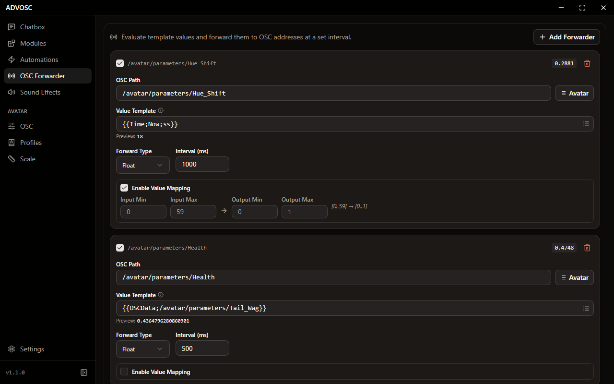

[Back to the README](../README.md)

# OSC Forwarder

  

Take any placeholder value and send it to an OSC address on a timer. The value field accepts any placeholder, so `{{OSCData;/avatar/parameters/X}}` and `{{Time;Now;HH:mm}}` both work.

Pick the target path by hand or straight from the current avatar's schema, then cast the value to `Float`, `Int`, `Bool` or `String`. You can remap numbers from one range to another (`0..1` to `0..255`, say), and each rule gets its own interval, down to 100 ms.
