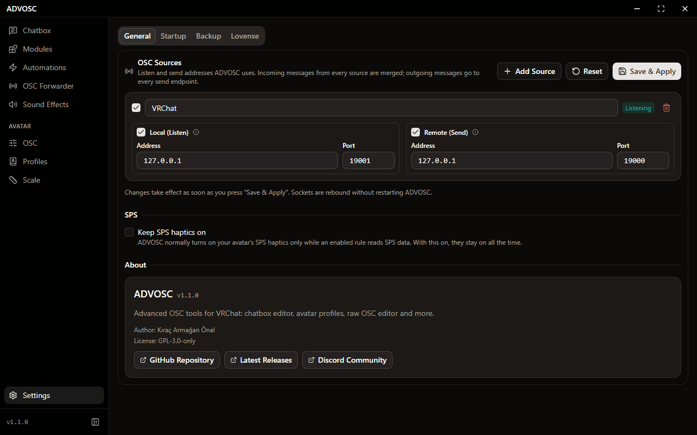

[Back to the README](../README.md)

# Settings

  

Most of what's in here you can leave alone. The defaults work with VRChat as it comes.

## OSC Sources

A source is an address ADVOSC listens on, sends to, or both. Out of the box there are two: VRChat (listens on 9001, sends to 9000) and a Secondary Listener on 9002 for other OSC apps.

Incoming messages from every source get merged, and outgoing messages go to every send endpoint. So if you run another OSC app, you can point it at the second listener, or add your own source with **Add Source**.

Changes apply when you press **Save & Apply**, and ADVOSC doesn't need a restart. **Reset** puts the defaults back.

## SPS haptics

ADVOSC normally turns on your avatar's SPS haptics only while an enabled rule reads SPS data. **Keep SPS haptics on** leaves them on all the time.

## Startup

**Start hidden** skips the window on launch, so ADVOSC goes straight to the tray. **GPU acceleration** is explained in [Tray and backups](./TRAY_AND_BACKUPS.md), and changing it needs a restart.

## Updates

The installed app checks for updates when it starts and every hour after that, and downloads them in the background. The **Updates** tab shows where that's at: the download with its progress and size, then a **Restart now** button once it's ready. **Check now** looks right away instead of waiting for the next hour. The same progress shows in the bottom left corner of the sidebar, where the version number normally is.

The zip build never updates itself, so the tab says so and points you at the releases page.

## Backup and Lovense

The **Backup** tab is covered in [Tray and backups](./TRAY_AND_BACKUPS.md). The **Lovense** tab is where you set up toy control, see [Toy control](./TOYS.md).
