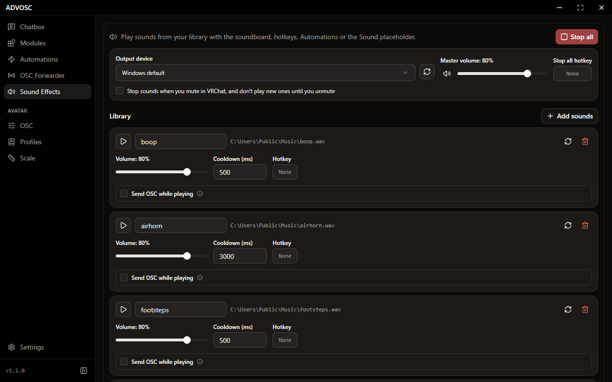

[Back to the README](../README.md)

# Sound Effects

  

A soundboard that reacts to your avatar.

Add audio files to the library and give each one a name. Each sound gets a play button, its own volume, a cooldown so it can't be spammed, and an optional global hotkey (press Esc on the hotkey button to clear it). Sounds layer on top of each other if you trigger them again.

A sound can also send an OSC value while it plays (for example `SoundPlaying=true`, then `false` when it ends), so an avatar animation can follow along. You can type the address or pick it from your avatar's parameters.

The files stay where they are on disk and aren't part of template exports. If you change a file, **Reload file** picks up the new version.

To make a sound react to something, add a **Play a sound** action to an [automation](./AUTOMATIONS.md). It plays one of its sounds at random, and a While rule can loop the sound or cut it off when the value stops matching. You can also play sounds from a template with the [Sound placeholder](./MODULES.md).

You can pick the output device, so a virtual audio cable can send the sounds into your VRChat mic. There's also a master volume, a mute button, a Stop all button with its own hotkey, and an option to stop everything and hold new sounds while you're muted in VRChat.

Most audio formats work: mp3, wav, flac, ogg, opus, webm, m4a and aac. HE-AAC files play with the high end missing, HE-AACv2 files don't play, and AAC files have a small gap when they loop. A file that can't play shows why next to its name.
